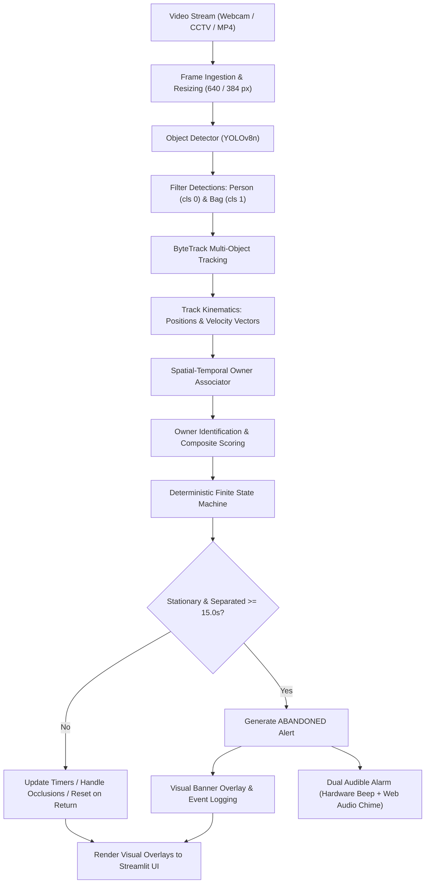

# Comprehensive Methodology & System Architecture

**Project Title:** Unattended / Abandoned Object Detection with Temporal Reasoning for Edge AI Surveillance  
**Repository Path:** `C:\Users\Aditya\.gemini\antigravity\scratch\abandoned_object_detection`  

---

## 1. Problem Statement & Motivation

Public transportation hubs, academic campuses, airport terminals, and commercial centers are high-density environments vulnerable to security threats and logistical hazards caused by unattended or abandoned baggage. Conventional closed-circuit television (CCTV) surveillance relies heavily on human operators scanning dozens of concurrent camera feeds. Human visual monitoring is prone to cognitive fatigue, distraction, and delayed response times.

Existing automated computer vision approaches suffer from fundamental limitations:
1. **Background Subtraction / Mixture of Gaussians (MOG2):** Flags any newly stationary pixel region as foreground, but fails catastrophically under dynamic lighting, shadows, camera vibrations, and walking crowds.
2. **Naive Object Detectors (YOLO / SSD alone):** Detects people and luggage, but has no concept of time, identity, or ownership. It cannot distinguish between an owner standing next to their suitcase and an owner who departed 10 minutes prior.

### Proposed Solution
Our system, **Unattended Object Detection with Temporal Reasoning**, decouples spatial perception from temporal reasoning. It combines an anchor-free lightweight detector (YOLOv8n), a class-consistent two-stage multi-object tracker (ByteTrack), a multi-factor spatial-temporal ownership association engine, and a deterministic finite state machine to detect abandoned items with minimal false alarms and sub-millisecond reasoning overhead.

---

## 2. Research Objectives

1. **Real-Time Edge Inference:** Achieve $\ge 25\text{ FPS}$ on edge CPU platforms and $> 45\text{ FPS}$ on hardware accelerators.
2. **False Positive Reduction:** Suppress spurious alarms on attended luggage, passing pedestrians, and stationary bags whose owners return within safety thresholds.
3. **Robust Identity Association:** Associate luggage with its true owner using spatial proximity, temporal persistence, and kinematic motion correlation without heavy deep appearance feature extractors.
4. **Resilient Temporal Reasoning:** Maintain tracking states and timers through transient pedestrian occlusions (up to $3.0\text{ seconds}$) and mitigate rapid boundary oscillation via hysteresis.

---

## 3. End-to-End System Architecture



---

## 4. Pipeline Stages & Mathematical Formulations

### Stage 1: Object Detection & Class Mapping
Ultralytics YOLOv8n performs single-stage detection on incoming frame $I_t \in \mathbb{R}^{H \times W \times 3}$.
Raw detections $D_t = \{(\mathbf{b}_i, s_i, c_i)\}_{i=1}^M$ where $\mathbf{b}_i = [x_1, y_1, x_2, y_2]$, $s_i \in [0, 1]$ is confidence, and $c_i \in [0, 79]$ is COCO class ID.

Target classes are filtered and mapped into internal labels $\mathcal{C} = \{0: \text{person}, 1: \text{bag}\}$:
$$c_{internal} = \begin{cases} 0 & \text{if } c \in \{0\} \quad (\text{person}) \\ 1 & \text{if } c \in \{24, 26, 28, 63\} \quad (\text{backpack, handbag, suitcase, laptop}) \\ \text{ignore} & \text{otherwise} \end{cases}$$

### Stage 2: Class-Consistent ByteTrack
Tracks $\mathcal{T} = \{\tau_1, \tau_2, \dots, \tau_K\}$ are updated separately for persons and bags.
1. **Detections Split:** Detections are split into high-confidence $D_{high}$ ($\text{conf} \ge \theta_{track}$) and low-confidence $D_{low}$ ($0.05 \le \text{conf} < \theta_{track}$).
   - For bags, $\theta_{track} = \min(\text{base\_thresh}, 0.20)$ to retain low-contrast luggage.
2. **Stage 1 Hungarian Match:**
   Cost matrix $C_{i,j} = 1 - \text{IoU}(\tau_i, d_j)$ for $d_j \in D_{high}$. Match if $C_{i,j} < \theta_{match} = 0.80$.
3. **Stage 2 Low-Confidence Match:**
   Unmatched tracks from Stage 1 are matched against $D_{low}$ with relaxed threshold $\theta_{match} + 0.10$.
4. **Kinematic Velocity Calculation:**
   $$\mathbf{v}(t) = \frac{\mathbf{p}(t) - \mathbf{p}(t - \Delta t)}{\Delta t}$$
   where $\mathbf{p}(t) = \left[\frac{x_1 + x_2}{2}, \frac{y_1 + y_2}{2}\right]^T$.

### Stage 3: Spatial-Temporal Owner Association
For every bag track $b \in \mathcal{T}_{bag}$ and candidate person track $p \in \mathcal{T}_{person}$, composite score $S(p, b)$ is computed:
$$S(p, b) = w_{dist} \cdot S_{dist} + w_{temp} \cdot S_{temp} + w_{motion} \cdot S_{motion}$$
where $w_{dist} = 0.45, w_{temp} = 0.35, w_{motion} = 0.20$.

1. **Spatial Proximity ($S_{dist}$):**
   $$d_{edge}(p, b) = \text{Euclidean edge-to-edge distance between boxes } \mathbf{b}_p \text{ and } \mathbf{b}_b$$
   $$S_{dist} = \max\left(0.0, 1.0 - \frac{d_{edge}(p, b)}{d_{max}}\right), \quad d_{max} = 250.0\text{ px}$$
2. **Temporal Consistency ($S_{temp}$):**
   $$S_{temp} = \min\left(1.0, \frac{\Delta t_{proximity}}{t_{attended\_min}}\right), \quad t_{attended\_min} = 1.0\text{ s}$$
3. **Kinematic Correlation ($S_{motion}$):**
   $$S_{motion} = \frac{\mathbf{v}_p \cdot \mathbf{v}_b}{\|\mathbf{v}_p\| \|\mathbf{v}_b\| + \epsilon}$$

Owner confirmation rule: If $S(p, b) \ge 0.40$ continuously for $\ge 1.0\text{ s}$, person $p$ is locked as `confirmed_owner_id`.

### Stage 4: Object Stationarity Verification
Displacement over rolling window $W = 3.0\text{ seconds}$:
$$\Delta d_b(t) = \|\mathbf{p}_b(t) - \mathbf{p}_b(t - 3.0\text{s})\|_2$$
$$\text{IsStationary}(b) = \begin{cases} \text{True} & \text{if } \Delta d_b(t) < 25.0\text{ px} \\ \text{False} & \text{if } \Delta d_b(t) \ge 25.0\text{ px} \end{cases}$$

### Stage 5: Finite State Machine & Decision Logic
The deterministic state machine tracks 7 states:
1. `UNKNOWN`: Transitory track initialization.
2. `ATTENDED`: $d(p, b) \le 180\text{ px}$ and $\text{IsStationary}(b) == \text{True}$.
3. `OWNER_MOVING_AWAY`: $d(p, b) > 120\text{ px}$ and relative departing speed $> 1.5\text{ px/s}$.
4. `SEPARATED`: $d(p, b) > 180\text{ px}$ or owner absent. Timer $\Delta t_{sep} = t - t_{start}$ starts.
5. `SUSPECTED_ABANDONED`: $\Delta t_{sep} \ge 7.5\text{ s}$ ($50\%$ of threshold).
6. `ABANDONED`: $\Delta t_{sep} \ge 15.0\text{ s}$ and $\text{IsStationary}(b) == \text{True}$. Alert triggered!
7. `RECOVERED`: Triggered if owner returns ($d \le 120\text{ px}$) OR bag moves ($\Delta d \ge 25\text{ px}$).

---

## 5. Pseudocode of Core Surveillance Pipeline

```python
def process_surveillance_frame(frame, timestamp):
    # 1. Detection
    detections = detector.predict(frame, conf=0.15, imgsz=384)
    
    # 2. Tracking
    active_tracks = tracker.update(detections, timestamp)
    person_tracks = [t for t in active_tracks if t.class_id == 0]
    bag_tracks    = [t for t in active_tracks if t.class_id == 1]
    
    # 3. Ownership Association
    ownership_records = associator.update(person_tracks, bag_tracks, timestamp)
    
    # 4. State Machine Reasoning
    new_alerts = []
    for bag in bag_tracks:
        st = state_machine.get_state(bag.id)
        is_stat = bag.displacement(window=3.0) < 25.0 # pixels
        owner_dist = ownership_records[bag.id].last_owner_distance
        
        if not is_stat:
            st.transition(RECOVERED, reason="Bag in motion")
            continue
            
        if owner_dist <= 120.0 and st.state in [SEPARATED, SUSPECTED, ABANDONED]:
            st.transition(RECOVERED, reason="Owner returned")
            continue
            
        if owner_dist > 180.0:
            if st.state == ATTENDED:
                st.transition(SEPARATED, reason="Owner separated")
                st.separation_start = timestamp
            
            sep_duration = timestamp - st.separation_start
            if sep_duration >= 15.0:
                st.transition(ABANDONED, reason="Separated >= 15.0s")
                if cooldown_passed(st):
                    new_alerts.append(create_alert(bag, sep_duration))
            elif sep_duration >= 7.5:
                st.transition(SUSPECTED, reason="Timer at 50%")
                
    return render_visuals(frame, active_tracks, new_alerts)
```
